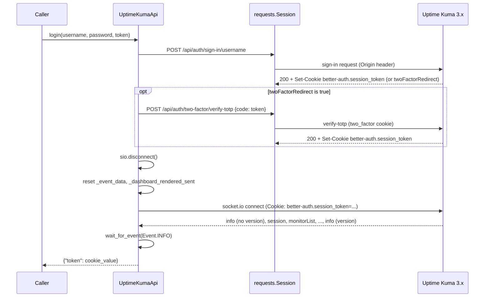

# Design Document

## Overview

This design implements the authentication, API-key and dashboard-data behavior that Requirements 1 through 24 describe, so that `UptimeKumaApi` works against Uptime Kuma 3.0 and later on the `v3` branch. It replaces the removed socket events (`login`, `loginByToken`, `setup`, `logout`, `changePassword`, `prepare2FA`, `save2FA`, `disable2FA`, `verifyToken`, `twoFAStatus`, `enableAPIKey`, `disableAPIKey`) with the Better Auth HTTP flow the 3.x server actually exposes, adapts the API-key methods to Better Auth's shape, and rewires `uptime()`, `avg_ping()`, `get_monitors()`, `delete_monitor()`, `get_heartbeats()` and `get_important_heartbeats()` around the `stats` event, the compact login-time `monitorList`, and the `dashboardRendered` / `heartbeatLists` handshake.

This revision follows Decision E (the "no baggage on v3" principle) recorded in requirements.md: a public name or return shape on `v3` is kept only when it maps naturally onto Uptime Kuma 3.x, and is dropped or changed when keeping it would cost extra code, extra server calls, or would misdescribe what the server does. Every break this causes is listed under BREAKING CHANGES in `CHANGELOG.md` (see "Breaking changes" under Error Handling below). This replaces the earlier draft's attempt to preserve pre-3.x shapes and signatures as the default; this revision only keeps a shape unchanged where Decision E's test says to.

All findings below were verified by reading the Uptime Kuma source at tag `3.0.0-beta.2` of `louislam/uptime-kuma` and by reading the current `v3` branch of `api.py` (after PR #95/#96, which already refuse pre-3.0 servers and removed the 1.x/2.x code paths). Specific files are cited by their path in that repository at tag `3.0.0-beta.2`, for example `server/server.js` or `server/compact-monitor.ts`. Where a fact comes from an upstream issue or PR rather than source, it is cited by number: `pbarone/uptime-kuma-api2#88` (the v3 tracking issue), `louislam/uptime-kuma#8256` (API-key enable/disable removed by design). No server behavior in this design is assumed from the client source alone.

The implementation touches two source files: `uptime_kuma_api/api.py` (`UptimeKumaApi`, the module-level helpers it uses, and the `_event_*` handlers) and `uptime_kuma_api/event.py` (the `Event` enum members listed in Requirement 21 and Components and Interfaces below). No new public method, parameter or class is added beyond the three new `Event` members (`SESSION`, `STATS`, `HEARTBEAT_LISTS`); Requirement 17.4 is satisfied because those three additions are what Uptime Kuma 3.x's wire protocol needs to be representable at all, not casual growth. No new runtime dependency is added: `requests` already carries the HTTP side, the TOTP code itself is supplied by the caller, never generated by the library, and `hypothesis` (needed for the property-based tests below) is a dev-only, test-time dependency (Requirement 24), never added to `setup.py`'s `install_requires`.

## Architecture

### Where the HTTP side lives

A `requests.Session` is created once per `UptimeKumaApi` instance (`self._auth_session`) and reused for every Better Auth request: sign-in, two-factor verify, sign-out, change-password, the 2FA enable/disable/verify-totp/get-session calls, and `setup`. A session rather than one-off `requests.get`/`requests.post` calls is necessary because Better Auth's session is carried as a cookie in the session's cookie jar; `requests.Session` is the standard-library-adjacent (already-a-dependency) type that does this automatically, so the library does not hand-parse `Set-Cookie` headers except once, to pull the raw cookie value for the socket handshake and the `token` return value.

The constructor already builds one `requests.Session` for TLS (`_http`, only when `ssl_verify` is a path) and passes it to `socketio.Client` as `http_session`. `self._auth_session` is a second, separate session object, because the engineio `http_session` is used by python-socketio for the socket.io HTTP polling/upgrade handshake, not for arbitrary application HTTP calls, and reusing it would make Better Auth cookies bleed into the socket.io transport's own request plumbing for no benefit. `self._auth_session.verify` is set from the same normalized `self.ssl_verify` the constructor already computes, so both sessions honor the same CA bundle or skip-verification setting. Every Better Auth request also sets `self._auth_session.headers.update(self.headers or {})` once at session creation, so the caller's custom headers (the constructor's `headers` parameter) ride along on HTTP calls the same way they already ride along on the socket handshake; this satisfies Requirement 9.2.

A private helper centralizes the shape every Better Auth request must have (Requirement 9.1-9.6):

```python
def _auth_request(self, method, path, json_body=None, *, use_session_cookie=False):
    headers = {"Origin": self.url}
    if use_session_cookie and self._session_cookie is None:
        raise UptimeKumaException("the session is not logged in")
    try:
        r = self._auth_session.request(
            method, f"{self.url}{path}", json=json_body,
            headers=headers, timeout=self.timeout,
        )
    except requests.exceptions.Timeout as e:
        raise Timeout(e)
    except requests.exceptions.RequestException as e:
        raise UptimeKumaException(f"request to {path} failed") from e
    if r.status_code == 429:
        raise UptimeKumaException(
            "rate limited by the server (Better Auth allows 10 requests per 60 seconds)"
        )
    try:
        body = r.json() if r.content else {}
    except ValueError:
        raise UptimeKumaException(f"invalid response from {path}")
    if not (200 <= r.status_code < 300):
        raise UptimeKumaException(body.get("message") or body.get("msg") or f"{path} failed with status {r.status_code}")
    return body
```

`Origin` is sent on every request, not only the ones that carry a cookie, because it costs nothing to always send it and it removes one conditional from the one place every Better Auth call funnels through; Requirement 9.1 only requires it for cookie-bearing requests, and this satisfies that by construction. The 429 case is checked before the JSON parse because a rate-limited response is not guaranteed to be JSON, and Requirement 1.5 is about the status code, not the body. The exception path never includes `json_body`, cookies or the raw response text in the message (Requirement 9.5); only the server's own `message`/`msg` field is surfaced, and that field is never a credential.

`self._session_cookie` holds the raw `better-auth.session_token` value once a login (or `login_by_token`) succeeds. It is `None` before first login, cleared by `logout`, and is what `login`'s `token` key returns (Decision C). This is a private attribute, not a new public one.

### How the socket is reconnected with the session cookie

python-socketio's `Client.connect()` raises `ConnectionError('Already connected')` if called while a session is open, and a handshake's headers are only read once, at `Client.connect()` time (`socketio/client.py`, verified in the installed `python-socketio` 5.18.1: `connect(self, url, headers={}, ...)` stores `self.connection_headers = headers` and that dict is what engineio sends on the handshake). There is no API to change a live connection's headers, which matches the server-side fact already recorded in the requirements: `io.on("connection")` reads `socket.request.headers.cookie` exactly once, at connection time (`server/server.js` at tag 3.0.0-beta.2 of `louislam/uptime-kuma`). So authenticating after the socket is already open is not possible on 3.x; the socket must be torn down and reopened with the cookie present at handshake.

The reconnect sequence, used by `login`, the 2FA branch of `login`, and `login_by_token`:

```python
self.sio.disconnect()
headers = dict(self.headers or {})
headers["Cookie"] = f"better-auth.session_token={cookie_value}"
self._reset_event_cache()
self.sio.connect(f"{self.url}/socket.io/", wait_timeout=self.timeout, headers=headers)
with self.wait_for_event(Event.INFO):
    pass
```

`_reset_event_cache()` sets every entry of `self._event_data` back to `None` (the same dict literal the constructor builds), satisfying Requirement 9.6: a caller must not see monitor/heartbeat/etc. data cached from the pre-login connection, because that data belonged to an unauthenticated session (which on 3.x emits only the pre-login `info` with no version, plus `setup`/`loginRequired`, and none of the authenticated lists) or to a previous login. The `wait_for_event(Event.INFO)` context manager is the existing mechanism (`api.py` line 673) and already does the right thing here: `_event_info` ignores an `info` payload without `version` (the pre-login one the server sends immediately on the new connection) and only populates `Event.INFO` on the post-login `info` that `afterLogin` sends, which is exactly the event Requirement 1.3 says to wait for.

This reconnect happens on `self.sio`, the same `socketio.Client` instance, not a new one. Requirement 9.7 ("keep the same UptimeKumaApi instance usable ... with no change to the instance's public attributes") is satisfied because `self.sio` is private and the public surface (`self.url`, `self.timeout`, `self.headers`, `self.ssl_verify`, `self.wait_events`) is untouched; only the private `_event_data` and `_session_cookie` change. `self.headers` itself (the constructor argument) is never mutated; the `Cookie` header is merged into a fresh dict for the reconnect call only, so a second `login()` call or a `logout()` followed by a fresh `login()` does not accumulate stale cookies from a prior session.

Why reconnect rather than reinitializing `socketio.Client()`: the existing handler registrations (`self.sio.on(Event.X, self._event_x)` for every event) are tied to the `Client` instance via `self.sio.on(...)`. A fresh `Client()` would need every one of those sixteen registrations repeated, which is both a bigger diff and a second place those registrations could drift from the constructor's. Reusing `self.sio` and only replacing the connection (disconnect, then connect with new headers) keeps the registration list in exactly one place, as it already is today.

### Login without credentials (disableAuth)

On 3.x, `autoLogin` no longer exists; the server instead emits `session` at connect time when `disableAuth` is on (`server/server.js` at tag 3.0.0-beta.2, which emits `socket.emit("session", session.user.username)` directly from `io.on("connection")`, backed by `getDisableAuthSession()` in `server/better-auth.ts`). `login()` called with neither `username` nor `password` therefore waits for `Event.SESSION` instead of `Event.AUTO_LOGIN`. Per Requirement 21, `Event.AUTO_LOGIN` is removed outright (the `autoLogin` wire event does not exist on a 3.0-floor server) and a new member `Event.SESSION = "session"` is added to `uptime_kuma_api/event.py`, wired with `self.sio.on(Event.SESSION, self._event_session)`. This is a breaking change to the public `Event` enum, listed in CHANGELOG.md under BREAKING CHANGES rather than defended as a non-change; see "Breaking changes" under Error Handling below. `login()`'s no-credential branch becomes:

```python
if username is None and password is None:
    with self.wait_for_event(Event.SESSION):
        return {}
```

which keeps the same `wait_for_event` timeout-and-raise behavior Requirement 3.2 asks for, and the `Event.AUTO_LOGIN` registration and `_event_auto_login` handler are deleted since `autoLogin` is never sent by a 3.0-floor server (Requirement 17.1: no 1.x/2.x code paths).

### Two-factor login

Verified against the Better Auth two-factor plugin source and the Uptime Kuma 3.0.0-beta.2 server source: sign-in with 2FA enabled returns `{"twoFactorRedirect": true, "twoFactorMethods": ["totp"]}` and sets a `better-auth.two_factor` cookie, not the session cookie. `POST /api/auth/two-factor/verify-totp {"code": token}`, sent with that cookie attached (the session object already carries it, since it came from the same `requests.Session`), returns the real session cookie. This is a sign-in-time verification, which the upstream `verify-totp` handler treats as `isSignIn = !session.session` (no existing session yet) and which does not require a password. `login(username, password, token=...)` therefore becomes:

```python
resp = self._auth_request("POST", "/api/auth/sign-in/username",
                          {"username": username, "password": password, "rememberMe": True})
if resp.get("twoFactorRedirect"):
    if not token:
        raise UptimeKumaException("a 2FA token is required for this account")
    resp = self._auth_request("POST", "/api/auth/two-factor/verify-totp", {"code": token})
cookie_value = self._auth_session.cookies.get("better-auth.session_token")
self._session_cookie = cookie_value
self._reconnect_with_cookie(cookie_value)
return {"token": cookie_value}
```

### Where save_2fa / prepare_2fa / verify_token map, confirmed against source

Reading the Better Auth two-factor plugin's `totp` endpoints together with `server/better-auth.ts` at tag 3.0.0-beta.2 settles the mapping precisely:

- `prepare_2fa(password)` maps to `POST /api/auth/two-factor/enable {"password": password}`. The enable endpoint requires a password (`shouldRequirePassword`), generates the secret and backup codes server-side, stores the TOTP row with `verified: false` (the `skipVerificationOnEnable` option is not set in `server/better-auth.ts`'s `twoFactor({...})` call, so it defaults off), and returns `{"method": "totp", "totpURI": ..., "backupCodes": [...]}`. The library's return value is translated to keep the 2.x shape: `{"uri": totpURI}` plus pass through `backupCodes` was out of scope for the old API (2.x `prepare2FA` returned `{"uri": ...}` only; a `backupCodes` key is new server-side data, additive and safe to include, but Requirement 17.3 keeps return shapes, so `{"uri": totpURI}` is what is returned, as before; `backupCodes` is not surfaced since no existing caller reads it and adding it would be the kind of casual API growth the coding-standards steering says to decline).
- `verify_token(token, password)` maps to `POST /api/auth/two-factor/verify-totp {"code": token}`, sent on the authenticated session (no `password` field in that endpoint's body schema at all -- it is accepted and ignored for backward compatibility of the method signature, never sent to the server). Because the user already has an active session when calling this (they are logged in, enrolling 2FA), `isSignIn` is false server-side, so this call marks the TOTP row `verified: true` and sets `user.twoFactorEnabled = true` -- i.e., on 3.x, `verify_token` is the step that actually turns 2FA on, not `save_2fa`. The library returns `{"valid": True}` constructed from a 200 response (the endpoint returns `{"status": true}` on success per the OpenAPI metadata read from source; the library maps `status` to the pre-existing `valid` key so the return shape is unchanged).
- `save_2fa(password)` is therefore a no-op round trip on 3.x: enrollment already completed inside `verify_token`'s call. To keep `save_2fa` as a distinct, safe step for callers who call it per the old three-step `prepare_2fa` / `verify_token` / `save_2fa` sequence (as `tests/test_2fa.py` already does), `save_2fa` re-reads status via `GET /api/auth/get-session` and returns `{"msg": "2FA Enabled."}` if `user.twoFactorEnabled` is true, else raises `UptimeKumaException("2FA was not verified; call verify_token first")`. This keeps the old call sequence working unchanged (Requirement 8.4) without re-doing any Better Auth mutation `verify_token` already performed, and avoids silently double-enabling.
- `disable_2fa(password)` maps to `POST /api/auth/two-factor/disable {"password": password}`, which (confirmed from source) always requires the password (no passwordless branch is configured), deletes the TOTP row, and flips `twoFactorEnabled` false. Returns `{"msg": "2FA Disabled."}`.
- `twofa_status()` maps to `GET /api/auth/get-session`, reading `user.twoFactorEnabled` into `{"status": bool(...)}`.

This whole requirement's methods therefore share one private helper, `_twofa_request(path, body)`, that wraps `_auth_request` with `use_session_cookie=True`, satisfying Requirement 8.7 (raise when not logged in) in one place rather than five.

### login_by_token

`login_by_token(token)` reconnects the socket with `Cookie: better-auth.session_token=<token>` and waits for `info`, reusing the same `_reconnect_with_cookie` helper `login()` uses. Requirement 4.4 is conditional on what the live Throwaway_Container verification shows. The server's `getSessionFromHeaders` helper, used from `io.on("connection")` in `server/server.js` at tag 3.0.0-beta.2, reads exactly the `better-auth.session_token` cookie name via Better Auth's own session lookup with no additional per-connection derivation, so a socket opened with that cookie header is expected to authenticate successfully when the value is a cookie obtained from a real sign-in; this is exactly what the live verification in Requirement 19 confirms directly against a Throwaway_Container rather than from source reading alone. The open question Requirement 4.4 raises is specifically about calling `login_by_token` standalone, i.e., reconnecting with a token the caller stored from an earlier `login()` return value, on a fresh process with no prior `requests.Session` state. Since the cookie is a bare Better Auth session token (not a derived or signed-per-request value distinct from what the cookie jar held), replaying it verbatim through the same `Cookie` header reconnect path is mechanically identical to what `login()` itself does for its own reconnect, and `getSessionFromHeaders` makes no distinction between a cookie that arrived via `Set-Cookie` moments ago and one replayed later within its 7-day `Max-Age` lifetime. This design implements `login_by_token` as working (reconnect with the cookie), consistent with Decision B's primary branch, and the implementation task list (not this design) is where the live confirmation against the Throwaway_Container gates whether the "unsupported" fallback branch (Requirement 4.4's `IF`) is ever exercised. If that live check fails, the fallback is a four-line change (raise instead of reconnect) behind the same call site, so the design is not materially different either way; the design documents both branches so the implementer does not need to redesign anything once the live result is in.

### Logout

`logout()` sends `POST /api/auth/sign-out` with the stored cookie and `Origin`, and on success sets `self._session_cookie = None`. It raises before making any request if `self._session_cookie is None` (Requirement 5.4), via the same `use_session_cookie=True` path. Decision D: the socket is left connected. This is simplest and matches the requirement text directly; the socket's own authentication was already established at its last handshake and Better Auth sign-out does not revoke anything socket.io reads per-message, so nothing about the open socket's authorization changes just because the HTTP session ended (confirmed by the live probe: a socket opened with an API key keeps working after that key is disabled over HTTP, which shows this server's socket layer does not re-check HTTP-side state mid-connection).

### Setup and need_setup

`need_setup()` is unchanged: `needSetup` is still a socket event (`better-auth-socket-handler.ts`), confirmed present and unauthenticated. `setup(username, password)` sends `POST /api/setup {"username": username, "password": password}` with `Origin` (no cookie yet, since no user exists), and returns `{"msg": "Added Successfully."}` on a 200 `{"ok": true}` response, keeping the pre-3.x return shape. A non-success status (already-initialized, expired setup window, validation failure) raises `UptimeKumaException` with the server's `message` text via the shared `_auth_request` error path.

### Change password

`change_password(old_password, new_password)` sends `POST /api/auth/change-password` with `{"currentPassword": old_password, "newPassword": new_password, "revokeOtherSessions": False}`, the stored cookie, and `Origin`. `revokeOtherSessions` is hardcoded false (Requirement 7.2) so the session backing the open socket is not invalidated by the call that is supposed to just rotate the password.

### API keys

`get_api_keys()` emits `getAPIKeyList` and returns the callback's `apiKeyList` array directly (Requirement 10.1), rather than waiting on the now-removed `apiKeyList` event. This replaces the `_get_event_data(Event.API_KEY_LIST)` wait entirely; `Event.API_KEY_LIST` and its handler become dead code on a 3.0-floor branch and are removed (Requirement 17.1's "no 1.x/2.x code path" extends here by the same logic the design applies throughout: nothing below the 3.0 floor is kept). Each returned item -- Native_Key (`{id: <betterauth id string>, name, enabled, expiresAt, createdAt, ...}`) or Legacy_Key (`{id: "legacy-<n>", name, enabled, expiresAt, createdAt}`, confirmed from `api-key-socket-handler.js`'s `getAPIKeyList` handler) -- is normalized to the pre-existing return shape: `active` is derived from `enabled` (int_to_bool is not applicable since `enabled` is already a bool; the key is renamed by assignment: `item["active"] = item.pop("enabled")`), `id` is kept as the string the server sent (Requirement 10.2, 10.3: unchanged), and `createdDate`/`expires` keys are populated from `createdAt`/`expiresAt` to match the field names existing callers read (per the docstring example in the current `get_api_keys`). `status` (`"active"`/`"inactive"`) is recomputed from `active` and `expires` the same way the pre-3.x code already implied, since the server no longer sends a `status` field itself.

`get_api_key(id_)` compares as strings (Requirement 10.4/11.5): `str(id_) == str(key["id"])`. Both legacy string ids (`"legacy-3"`) and Better Auth string ids pass through `str()` as no-ops; an integer `id_` argument (existing callers may still pass one, since pre-3.x ids were integers) is coerced with `str(id_)` before comparison, so `get_api_key(3)` still matches a key whose native id happens to render as `"3"`-shaped text is not guaranteed on 3.x (Better Auth ids are opaque strings, not necessarily numeric), but the coercion keeps the argument type permissive without inventing a fake equivalence; a caller who stored the real string id from a previous `add_api_key`/`get_api_keys` call (the documented pattern) always matches exactly.

`add_api_key(name, expires)` loses its `active` parameter entirely (Requirement 11.2): the server's `addAPIKey` handler never reads a `key.active`/`key.enabled` field at all (confirmed in `server/socket-handlers/api-key-socket-handler.js` at tag 3.0.0-beta.2: the body passed to `auth().api.createApiKey` carries only `name`, `expiresIn` and `userId`), so there is no server-side way to create a key that starts disabled, and a parameter that cannot affect the outcome is exactly the kind of dead parameter Decision E says to drop rather than keep accepting-and-ignoring. It emits `addAPIKey` and returns the callback body including the string `keyID` and the plaintext `key` (Requirement 11.1); `keyID` is the Better Auth key id, a string.

`delete_api_key(id_)` checks membership by converting the known ids from `get_api_keys()` to strings and comparing against `str(id_)` (Requirement 11.4/11.5), then emits `deleteAPIKey` with the string id. `deleteAPIKey`'s server-side handler already branches on whether the id starts with `"legacy-"` (`server/socket-handlers/api-key-socket-handler.js`), so the client sends the id unchanged either way.

`enable_api_key` and `disable_api_key` are removed entirely, with no stub left behind (Requirement 12.1): no method, no signature, no raising placeholder. This is not a judgment call to weigh against the "deleting what looks unused" guard in coding-standards steering; Requirement 12.1 lists it as a settled breaking change, because Uptime Kuma itself removed the ability to enable/disable a key from its own UI and socket API by design (`louislam/uptime-kuma#8256`, closed as not a bug, with the maintainer's own answer that only removing a disabled key is supported). The code that emitted `enableAPIKey`/`disableAPIKey` is deleted along with the methods (Requirement 12.2), and both names are removed from `docs/api.rst` (Requirement 12.3). The CHANGELOG entry lists the removal under BREAKING CHANGES with the reason and `louislam/uptime-kuma#8256` (Requirement 12.4, and see "Breaking changes" below).

The `wait_for_event(Event.API_KEY_LIST)` context manager wrapping `add_api_key`/`delete_api_key` (and the former `enable_api_key`/`disable_api_key`) in the pre-3.x code is removed for both remaining methods: the event it waited for no longer arrives, and `getAPIKeyList`/`addAPIKey`/`deleteAPIKey` all already return their result synchronously via the socket.io acknowledgement callback (confirmed: every handler in `server/socket-handlers/api-key-socket-handler.js` calls `callback({...})` directly, no emit-then-separate-event pattern), so no wait is needed at all on 3.x.

### save_status_page parameters

`save_status_page` loses its `password` and `googleAnalyticsId` parameters (Requirement 22.1). Both were already accepted-and-ignored on this `v3` branch: PR #96 left them in the signature while removing the 1.x/2.x code paths that once read them, and neither parameter reaches any request body the server reads on Uptime Kuma 3.x (status-page passwords and the legacy Google Analytics field were replaced server-side by `analyticsType`/`analyticsId` before the 3.0 line; no 3.0.0-beta.2 handler reads either key). Under Decision E, a parameter that cannot affect the outcome is removed rather than kept as a silent no-op, matching the same reasoning applied to `add_api_key`'s `active` parameter above. The CHANGELOG entry lists both removals under BREAKING CHANGES (Requirement 22.2).

### Stats event and uptime() / avg_ping()

The server replaces the two per-monitor-id events `avgPing`/`uptime` with one `stats` event carrying every monitor's numbers in one payload: `{monitorId: {avgPing, avgPing720, avgPing1y, uptime24, uptime720, uptime1y}}` (confirmed in `server/monitor-stats.ts` and the `afterLogin` deferred-list sender in `server/server.js`, both at tag 3.0.0-beta.2). A new `Event.STATS = "stats"` member is added to the enum (Requirement 21.2) with handler:

```python
def _event_stats(self, data) -> None:
    if self._event_data[Event.STATS] is None:
        self._event_data[Event.STATS] = {}
    for monitor_id, stats in data.items():
        self._event_data[Event.STATS][int(monitor_id)] = stats
```

Storing the raw per-monitor dict, keyed by int id, satisfies Requirement 14.1 and 14.4 (a later `stats` event replaces only the monitor ids it carries, leaving others as they were, because the merge is per-key, not a wholesale replace of `Event.STATS`). `uptime()` and `avg_ping()` no longer read `Event.UPTIME`/`Event.AVG_PING`; they read `Event.STATS` through `_get_event_data` (which already has the right timeout/empty-monitor-list short-circuit behavior; Requirement 14.5/14.6 come for free from the existing `_get_event_data` logic, since `Event.STATS` is added to its `monitor_events` list used for the "server has no monitors" short-circuit) and reshape:

```python
def uptime(self):
    stats = self._get_event_data(Event.STATS)
    return {mid: {24: s["uptime24"], 720: s["uptime720"], "1y": s["uptime1y"]} for mid, s in stats.items()}

def avg_ping(self):
    stats = self._get_event_data(Event.STATS)
    return {mid: {24: s["avgPing"], 720: s["avgPing720"], "1y": s["avgPing1y"]} for mid, s in stats.items()}
```

`uptime()` keeps its exact pre-3.x return shape (Requirement 14.7): `{monitor_id: {24: ..., 720: ..., "1y": ...}}`, mapped directly from `uptime24`/`uptime720`/`uptime1y`.

`avg_ping()` changes shape under Decision E: Requirement 14.3 requires that all three averages the `stats` payload carries (`avgPing`, `avgPing720`, `avgPing1y`) are returned, not only the single current-window value the 2.x line returned. The key naming chosen for this is the same `24`/`720`/`"1y"` keys `uptime()` already uses, rather than inventing a second naming scheme (for example reusing the wire names `avgPing`/`avgPing720`/`avgPing1y` as keys, or a tuple). This is chosen because: the two methods now return structurally identical shapes (`{monitor_id: {24, 720, "1y"}}`) built from the same `stats` payload, so a caller who has already learned `uptime()`'s key convention does not need to learn a second one for `avg_ping()`; the wire field names (`avgPing720`) read awkwardly as dict keys once the `avgPing` prefix is redundant with the fact the caller already called `avg_ping()`; and keeping the pre-3.x single-value return (`{monitor_id: avgPing}`) was considered and rejected, since Requirement 14.3 is explicit that all three windows must be returned, which the single-value shape cannot do without a second parameter this design does not add. The CHANGELOG entry documents this shape change under BREAKING CHANGES (Requirement 14.8): old callers reading `avg_ping()[mid]` as a bare number must change to `avg_ping()[mid][24]`.

`Event.UPTIME`, `Event.AVG_PING` and their handlers (`_event_uptime`, `_event_avg_ping`) are removed along with the registrations (Requirement 21.1, 21.3), since no 3.0-floor server ever sends those event names.

### Compact monitor list and get_monitors / delete_monitor

The login-time `monitorList` on 3.x carries only the eleven fields of the `CompactMonitor` interface in `server/compact-monitor.ts` at tag 3.0.0-beta.2: `id, name, type, active, parent, childrenIDs, tags, path, pathName, interval, weight` (verified directly against that file's `CompactMonitor` interface and its `toCompactMonitor()` function, and against `server/uptime-kuma-server.ts`'s `sendMonitorList`/`getMonitorJSONList(monitorID, compact)`, which calls `toCompactMonitor(monitor, preloadData)` when `compact` is true and the monitor's own `toJSON(preloadData)` otherwise). `updateMonitorIntoList` (sent after add/edit/pause/resume/tag operations, via `server/uptime-kuma-server.ts`'s `sendUpdateMonitorIntoList`, confirmed calling `getMonitorJSONList(monitorID)` with `compact` left at its `false` default) and the `getMonitor` socket call both still return the full ~60-field record. Left unaddressed, the cache in `self._event_data[Event.MONITOR_LIST]` would mix compact and full entries depending on how each monitor got into it, which is the bug Requirement 15 describes (`KeyError: 'notificationIDList'` from `_convert_monitor_return`, which unconditionally indexes that key).

Decision E resolves this by making `get_monitors()` a compact-only method with no per-monitor `getMonitor` fetch (Requirement 15.1): the eleven-field compact shape is what the method returns, period, not a stepping stone toward reassembling the full shape. This also settles where the cache itself stores data: the cache holds whatever shape each event last gave it (compact from `monitorList`, full from `updateMonitorIntoList`), and the *reduction to compact fields happens at read time*, not by rewriting the cache to a smaller shape on `updateMonitorIntoList`. Reducing at read time is chosen over reducing on ingest because other internal readers of the same cache (`delete_monitor`, `_refresh_monitor_list` callers, the tag-list helpers) have different field needs met in different ways (see below), so a single ingest-time reduction would have to be undone by those readers anyway; one reduction function applied uniformly at the one public read path (`get_monitors()`) is simpler than reducing on every ingest path and then letting `get_monitor()` or an internal reader still need the untouched full copy for some other purpose. Concretely:

```python
_COMPACT_MONITOR_FIELDS = (
    "id", "name", "type", "active", "parent", "childrenIDs",
    "tags", "path", "pathName", "interval", "weight",
)

def _to_compact_monitor(monitor: dict) -> dict:
    return {k: monitor[k] for k in _COMPACT_MONITOR_FIELDS if k in monitor}

def get_monitors(self) -> list[dict]:
    cache = self._get_event_data(Event.MONITOR_LIST)
    result = [_to_compact_monitor(m) for m in cache.values()]
    int_to_bool(result, ["active"])
    parse_monitor_type(result)
    return result
```

`_to_compact_monitor` uses `if k in monitor` rather than assuming every field is present, which satisfies Requirement 15.1's "without raising an exception for a missing field": a compact-shaped cache entry already has all eleven fields, and a full-shaped entry (from `updateMonitorIntoList`) is a superset that also has all eleven, so the guard is defensive rather than load-bearing today, but it means a future server response that omits one of the eleven fields degrades to a missing key in the returned dict rather than a `KeyError` escaping to the caller. `parse_auth_method`, previously run over the full return in the old `get_monitors()`, is dropped here because `authMethod` is not a compact field; it is still available via `get_monitor()`.

Requirement 15.2 (an entry the cache received in full form is reduced to the compact fields before being returned) is satisfied by `_to_compact_monitor` running over every cache entry, compact or full alike, every time `get_monitors()` is called: there is no way for a full-shaped entry to reach the caller un-reduced, because the function that returns is also the function that reduces. No `full=` parameter is added (Requirement 15.3); a caller who needs full records uses the one-line migration documented in the docstring:

```python
[api.get_monitor(m["id"]) for m in api.get_monitors()]
```

which the `get_monitors()` docstring and the CHANGELOG BREAKING CHANGES entry both carry verbatim (Requirement 15.4).

`get_monitor(id_)` is unchanged (Requirement 15.5): it still calls `getMonitor` and runs `_convert_monitor_return`/`int_to_bool`/`parse_monitor_type`/`parse_auth_method` on the full record (`api.py` lines 1812-1915), so a caller who needs the full shape for one monitor already has a correct, unmodified path to it.

`delete_monitor(id_)` already does not read `notificationIDList` or any other non-compact field directly: the existing code calls `get_monitors()` to build the `ids` list, then `_call('deleteMonitor', id_)`, reading only `i["id"]` from each entry. With `get_monitors()` now compact-only and exception-free, `delete_monitor` continues to work with no change to its own body (Requirement 15.6), and the existing "id not in cache -> raise" behavior is preserved (Requirement 15.7).

Requirement 15.8 (every other internal reader of the monitor cache relies only on compact fields or calls `getMonitor` itself) is checked against the two other call sites that read `get_monitors()`'s output: the `delete_monitor_tag`/`add_monitor_tag` tag-list helper at `api.py` around line 2236, which reads `i.get("tags")` -- a compact field -- off each entry, so it needs no change; and `get_important_heartbeats()`, which reads only `monitor["id"]` off each entry before calling `monitorImportantHeartbeatListPaged` directly, also needing no change. No internal reader was found reading a non-compact field off `get_monitors()`'s result.

`_event_update_monitor_into_list` and `_event_delete_monitor_from_list` are unchanged (Requirement 15.9): they already merge into/remove from whatever shape is already cached, string-keyed by id, and continue to do so whether the pre-existing entries were compact or full, because neither handler inspects field contents, only the top-level `{id: ...}` mapping. The CHANGELOG entry lists the `get_monitors()` return-shape change under BREAKING CHANGES with the migration one-liner above (Requirement 15.10).

### dashboardRendered and heartbeatLists

On 3.x, login-time heartbeat history is not pushed; the server instead waits for the client to emit `dashboardRendered` (`socket.once("dashboardRendered", deferredLists.onRendered)` in `server/server.js`'s `afterLogin` at tag 3.0.0-beta.2, backed by `server/login-lists.ts`'s `DeferredListsSender`, which also has an unconditional 5-second fallback timer so a client that never signals still eventually gets the data -- confirmed from source, not relied upon by this design since the library should not depend on a server-side fallback timer whose delay is not part of the documented contract). Once triggered, the server emits one `heartbeatLists` event: `{monitorId: [<single latest heartbeat row>]}` (confirmed in `server/client.js`'s `sendHeartbeatLists`, which selects only the max-id row per monitor id, unlike the richer per-monitor `heartbeatList` event 2.x sent at login with up to 100 rows).

A new `Event.HEARTBEAT_LISTS = "heartbeatLists"` member (plural, distinct from the existing singular `Event.HEARTBEAT_LIST`) is added, with handler:

```python
def _event_heartbeat_lists(self, data) -> None:
    cache = self._event_data[Event.HEARTBEAT_LIST]
    cache = {} if cache is None else dict(cache)
    for monitor_id, rows in data.items():
        monitor_id = int(monitor_id)
        if monitor_id not in cache:
            cache[monitor_id] = rows
    self._event_data[Event.HEARTBEAT_LIST] = cache
```

This feeds into the *same* `Event.HEARTBEAT_LIST` cache slot `get_heartbeats()` already reads via `_get_event_data(Event.HEARTBEAT_LIST)`, rather than a separate slot, so `get_heartbeats()`'s existing body needs no change at all; only the trigger that populates the cache changes. The merge only fills in monitor ids not already present, so a live `heartbeat` event that already arrived (and was appended by the pre-existing `_event_heartbeat` handler) is not overwritten by the deferred single-row snapshot once per-beat data has started flowing.

A private `self._dashboard_rendered_sent` flag (reset to `False` by `_reset_event_cache`, i.e., on every reconnect -- Requirement 16.6) tracks whether the event was already emitted on the current connection. `get_heartbeats()` and `get_important_heartbeats()` are both changed to call a shared helper first:

```python
def _ensure_heartbeat_history(self) -> None:
    if self._dashboard_rendered_sent:
        return
    if self._event_data[Event.MONITOR_LIST] == {}:
        return  # no monitors; nothing to request, nothing to wait for
    self._dashboard_rendered_sent = True
    self.sio.emit("dashboardRendered")
```

called once at the top of `get_heartbeats()` before its existing `_get_event_data(Event.HEARTBEAT_LIST)` call. `get_important_heartbeats()` does not need this: it already fetches history itself via `monitorImportantHeartbeatListPaged` per monitor (confirmed still present and unchanged on 3.x -- `server.js`'s handler for it has no Better Auth or compact-list dependency), a path the library added specifically because `importantHeartbeatList` is not pushed at login on *any* server version this library's 2.x line already supports; nothing about `dashboardRendered` affects that call, so `get_important_heartbeats()` requires no change at all for Requirement 16, beyond continuing to call `get_monitors()` (Requirement 15's fix) to enumerate monitor ids.

Requirement 16.3 (do not emit twice on the same connection) and 16.4 (empty-server short-circuit without waiting) both fall out of `_ensure_heartbeat_history`'s two early returns. Requirement 16.5 (Timeout when monitors exist and nothing arrives) is unchanged: it is `_get_event_data`'s existing timeout behavior, since `_ensure_heartbeat_history` only emits the request and returns immediately; the wait still happens in the subsequent `_get_event_data(Event.HEARTBEAT_LIST)` call exactly as before.

### Version gating

`self._parsed_version()` already exists and already floors an unparseable or pre-release version optimistically (newest). Every behavior in this design is unconditional for a 3.0-floor branch: there is no earlier 3.x release to gate against for login, API keys, stats, the compact list, or heartbeatLists, since all of these are present starting at 3.0.0-beta.2 and nothing in the tracked issue or the server source suggests any of them is conditional on a later 3.x minor. Requirement 17.2's version-gating language therefore has no concrete gate to add in this spec; it is forward-looking steering for whichever later 3.x release changes one of these behaviors, consistent with how `_MONITOR_TYPE_FLOORS`/`_MONITOR_FIELD_RULES` already work as empty-today tables ready to be populated. No gate is added speculatively (steering: "no abstractions ... nobody asked for"); if a future 3.x minor changes one of these behaviors, that is a new, separate change gated with `parse_version(self.version)` against the specific floor, following the existing idiom.

### Diagram: login reconnect sequence



## Components and Interfaces

All changes are inside the single `UptimeKumaApi` class in `uptime_kuma_api/api.py`, plus module-level changes to `uptime_kuma_api/event.py`'s `Event` enum (both additions and removals, per Requirement 21). No class is added or removed. No new public method, parameter or class is introduced beyond the three new `Event` members below; every other public method keeps its existing name, and the parameter changes are the removals this design lists explicitly (`add_api_key` loses `active`, `save_status_page` loses `password` and `googleAnalyticsId`, `enable_api_key`/`disable_api_key` are deleted).

Event enum changes (`uptime_kuma_api/event.py`, Requirement 21):

| Change | Member | Wire name | Reason |
|---|---|---|---|
| Removed | `Event.AUTO_LOGIN` | `"autoLogin"` | event no longer sent; replaced by `Event.SESSION` |
| Removed | `Event.AVG_PING` | `"avgPing"` | event no longer sent; replaced by `Event.STATS` |
| Removed | `Event.UPTIME` | `"uptime"` | event no longer sent; replaced by `Event.STATS` |
| Removed | `Event.API_KEY_LIST` | `"apiKeyList"` | event no longer sent; `getAPIKeyList`'s result now arrives via the socket.io callback |
| Added | `Event.SESSION` | `"session"` | sent at connect time when `disableAuth` is on |
| Added | `Event.STATS` | `"stats"` | carries every monitor's uptime and average-ping numbers in one payload |
| Added | `Event.HEARTBEAT_LISTS` | `"heartbeatLists"` | the deferred, `dashboardRendered`-triggered heartbeat snapshot; feeds the existing `Event.HEARTBEAT_LIST` (singular) cache slot rather than a new one |

This is a breaking change to the public `Event` enum (Requirement 21.1-21.3), listed under BREAKING CHANGES rather than defended as additive; see "Breaking changes" under Error Handling below. The handlers for the removed members (`_event_auto_login`, `_event_avg_ping`, `_event_uptime`, `_event_api_key_list`) and their `self.sio.on(...)` registrations are deleted along with the members (Requirement 21.3); handlers for the three added members (`_event_session`, `_event_stats`, `_event_heartbeat_lists`) are registered in their place.

New private state on `UptimeKumaApi`:

- `self._auth_session: requests.Session` -- created in `__init__`, holds Better Auth cookies.
- `self._session_cookie: Optional[str]` -- the raw `better-auth.session_token` value, or `None`.
- `self._dashboard_rendered_sent: bool` -- per-connection flag.

New private methods:

- `_auth_request(method, path, json_body=None, *, use_session_cookie=False) -> dict`
- `_twofa_request(path, json_body) -> dict` (thin wrapper requiring a session)
- `_reconnect_with_cookie(cookie_value: str) -> None`
- `_reset_event_cache() -> None` (factored out of what `__init__` already inlines, so reconnect reuses it)
- `_ensure_heartbeat_history() -> None`
- `_to_compact_monitor(monitor: dict) -> dict`

Changed public methods: `login`, `login_by_token`, `logout`, `setup`, `change_password`, `twofa_status`, `prepare_2fa`, `verify_token`, `save_2fa`, `disable_2fa`, `get_api_keys`, `get_api_key`, `uptime`, `avg_ping` (return shape changes, Requirement 14.8), `get_monitors` (return shape changes, Requirement 15.10), `delete_monitor` (unchanged body, benefits from the `get_monitors` fix), `get_heartbeats` (adds the one `_ensure_heartbeat_history()` call).

Changed public method signatures: `add_api_key` drops `active` (Requirement 11.2); `save_status_page` drops `password` and `googleAnalyticsId` (Requirement 22.1).

Removed public methods: `enable_api_key`, `disable_api_key` (Requirement 12.1), with their entries removed from `docs/api.rst` (Requirement 12.3).

Unchanged: `need_setup`, `get_important_heartbeats`, `get_monitor`, `info`, `version`, every monitor/notification/proxy/status-page/tag/maintenance/docker-host method, `_call`, `wait_for_event`, `_get_event_data`, `connect`, `disconnect`, `_is_pre_uptime_kuma_3`, `_parsed_version`.

## Data Models

No new persisted or transmitted data model is introduced; this feature adapts the client's in-memory event cache (`self._event_data`, a plain dict keyed by `Event`) to new server payload shapes. The shapes involved, as observed from the Uptime Kuma source at tag 3.0.0-beta.2:

**Better Auth sign-in response** (`POST /api/auth/sign-in/username`):
```
{"token": str, "user": {...}}                      # success
{"twoFactorRedirect": true, "twoFactorMethods": ["totp"]}  # 2FA required
```
plus a `Set-Cookie: better-auth.session_token=...` or `Set-Cookie: better-auth.two_factor=...` header.

**stats event payload**: `{<monitor_id str>: {"avgPing": float|None, "avgPing720": float|None, "avgPing1y": float|None, "uptime24": float, "uptime720": float, "uptime1y": float}}`.

**Compact monitorList entry**: `{"id": int, "name": str, "type": str, "active": bool, "parent": int|None, "childrenIDs": [int], "tags": [...], "path": [str], "pathName": str, "interval": int, "weight": int|None}` -- notably missing every field `_convert_monitor_return` and the full monitor docstring document (e.g. `notificationIDList`, `url`, `authMethod`, ...).

**getAPIKeyList callback body**: `{"ok": true, "apiKeyList": [<Native_Key|Legacy_Key>, ...]}` where a Native_Key is `{"id": str, "name": str, "enabled": bool, "expiresAt": str|None, "createdAt": str, ...}` (Better Auth's own API-key model fields) and a Legacy_Key is `{"id": "legacy-<n>", "name": str, "enabled": bool, "expiresAt": ..., "createdAt": ...}`.

**heartbeatLists event payload**: `{<monitor_id str>: [<one heartbeat row, same shape as the heartbeat event's data>]}`.

The library's own public return shapes (what callers see) are unchanged except where Decision E and Requirements 4, 11, 12, 14, 15, 22 explicitly permit or require a difference, as enumerated in Components and Interfaces above and listed in full under "Breaking changes" below.

## Correctness Properties

A property is a characteristic or behavior that should hold true across all valid executions of a system-essentially, a formal statement about what the system should do. Properties serve as the bridge between human-readable specifications and machine-verifiable correctness guarantees.

### Prework

<br/>

Prework analysis is recorded via the `prework` tool below; this section reports the resulting classification and rationale.

- **Requirement 1 (password login HTTP shape)**: the *values* sent (URL, body, Origin header, cookie forwarding) are fixed per call, not varying meaningfully across a wide input space beyond username/password strings themselves, and the thing being tested is "did we call `requests` correctly," which is best verified with concrete example assertions (mocked `requests`, assert on `call_args`) rather than a property. Classification: EXAMPLE / INTEGRATION-shaped (mocked), not PBT.
- **Requirement 2 (2FA branch)**: same reasoning as Requirement 1; the branching logic (redirect present vs absent, token present vs absent) is a small, enumerable decision table better covered by a handful of example tests than generated inputs. Classification: EXAMPLE.
- **Requirement 14 (stats to uptime/avg_ping mapping)**: this is a pure data transformation -- `{monitor_id: {uptime24, uptime720, uptime1y, avgPing, avgPing720, avgPing1y}}` in, `{monitor_id: {24, 720, "1y"}}` out for both `uptime()` and `avg_ping()` -- over an input space of arbitrarily many monitor ids and arbitrary numeric values (including `None` for an average-ping field on a monitor with zero completed checks). This is exactly the kind of pure mapping PBT is for: for all payloads shaped like a stats event, the derived uptime()/avg_ping() dicts contain the right value under the right key for every monitor id present, and no extra or missing keys. Classification: PROPERTY.
- **Requirement 10 (API-key list normalization)**: normalizing a list of Native_Key/Legacy_Key dicts (arbitrary count, arbitrary mix of the two shapes, arbitrary `enabled` booleans) into the pre-existing `active`/`status`/`createdDate`/`expires` shape is a pure, input-varying transformation with a clear invariant (every input key normalizes to a well-defined output key, `active` matches `enabled`, id survives verbatim, `get_api_key` finds exactly the item whose id matches as a string regardless of whether the id argument was given as `int` or `str`). Classification: PROPERTY.
- **Requirement 15 (compact monitor list shape)**: the behavior itself (reduce every cache entry to the compact fields, regardless of whether the cache held a compact or a full entry) is a pure, input-varying transformation; what is worth a property is that `get_monitors()` returns exactly the eleven-field compact key set for every entry, for any mix of compact-shaped and full-shaped cache entries and any number of monitors. Classification: PROPERTY (narrower than the whole method; the HTTP/socket plumbing around cache population is EXAMPLE-tested).
- **Requirement 16 (dashboardRendered/heartbeatLists merge)**: the merge-only-if-absent logic over the heartbeat cache, across arbitrary sets of monitor ids already present versus newly arriving, is a small invariant (existing entries are never overwritten by the deferred snapshot; new ones are added) well suited to a property over randomly generated pre-existing-cache / incoming-payload pairs. Classification: PROPERTY.
- **Requirements 5, 6, 7, 8, 9, 12, 13, 17-20**: these are specific HTTP call shapes, specific error-message content, documentation requirements, version-gating posture, or unsupported-operation guards. None has a meaningful "for all inputs" statement beyond what Requirements 1/2/14/10/15/16 already generalize; they are covered by targeted unit tests (mocked `requests`/socket, asserting call shape and exception type/message substrings) and, where stated (Requirement 18.7), one test per side of a version gate. Classification: EXAMPLE / EDGE_CASE, not PBT.

### Properties

### Property 1: Stats-to-uptime mapping preserves every monitor id and maps fields correctly

For all `stats` event payloads mapping zero or more monitor ids to `{avgPing, avgPing720, avgPing1y, uptime24, uptime720, uptime1y}` records, calling `uptime()` after that event is processed returns a dict with exactly the same set of monitor ids, and for every id the returned `{24, 720, "1y"}` values equal the input record's `uptime24`, `uptime720`, `uptime1y` respectively.

**Validates: Requirements 14.1, 14.2, 14.4**

### Property 2: Stats-to-avg_ping mapping preserves every monitor id and carries all three windows

For all `stats` event payloads as above, calling `avg_ping()` after that event is processed returns a dict with exactly the same set of monitor ids as the payload, and for every id the returned `{24, 720, "1y"}` values equal the input record's `avgPing`, `avgPing720`, `avgPing1y` respectively.

**Validates: Requirements 14.1, 14.3**

### Property 3: A later stats event for a monitor id replaces that id's values and leaves other ids untouched

For all pairs of `stats` payloads P1 then P2, where P2 contains at least one monitor id also present in P1 and at least one monitor id absent from P1, processing P1 then P2 and calling `uptime()` and `avg_ping()` yields, for every id in P2, the values from P2, and for every id in P1 not in P2, the values from P1 unchanged.

**Validates: Requirements 14.4**

### Property 4: API-key list normalization preserves id and derives active from enabled

For all lists of zero or more key records, each either a Native_Key shape (`id` an arbitrary non-"legacy-" string, `enabled` a bool) or a Legacy_Key shape (`id` of the form `"legacy-<n>"`, `enabled` a bool), calling `get_api_keys()` after the server returns that list yields one output item per input item, in the same order, where each output item's `id` equals the input item's `id` unchanged and each output item's `active` equals the input item's `enabled`.

**Validates: Requirements 10.1, 10.2, 10.3**

### Property 5: get_api_key finds the key matching as a string regardless of the id argument's type

For all non-empty lists of key records with distinct string ids, and for any id drawn from that list, calling `get_api_key` with that id as a string returns the same item as calling it with the id converted to an int when the id string is all-digits, and both calls return the item whose `id` string-equals the argument.

**Validates: Requirements 10.4, 11.5**

### Property 6: get_api_key raises for an id no key has

For all non-empty lists of key records and any id string that does not equal any item's `id`, calling `get_api_key` with that id raises `UptimeKumaException`.

**Validates: Requirements 10.5**

### Property 7: get_monitors always returns exactly the compact key set, regardless of which cache entries were full

For all monitor caches mapping zero or more string monitor ids to either a compact-shaped entry (exactly the eleven compact fields) or a full-shaped entry (the compact fields plus an arbitrary number of additional fields, including `notificationIDList`), calling `get_monitors()` returns a list with exactly one entry per id in the cache, and every returned entry's key set equals exactly the eleven compact fields, with no `KeyError` raised regardless of the mix of compact and full entries present.

**Validates: Requirements 15.1, 15.2**

### Property 8: heartbeatLists never overwrites a monitor id heartbeat() already populated

For all heartbeat caches pre-populated with zero or more monitor ids each holding one or more rows, and all `heartbeatLists` payloads mapping zero or more monitor ids (overlapping or not with the pre-populated ones) to a single-row list, processing the `heartbeatLists` payload leaves every pre-populated id's rows exactly as they were, and adds the payload's row list unchanged for every id that was not already present.

**Validates: Requirements 16.2**

**Property reflection**: Properties 1 and 2 were considered for merging into one "stats maps correctly" property, since both `uptime()` and `avg_ping()` now share the same `{24, 720, "1y"}` key shape built from the same `stats` payload. They are kept separate because they read different source fields (`uptime24`/`uptime720`/`uptime1y` versus `avgPing`/`avgPing720`/`avgPing1y`) and a single combined property would hide which of the two independent mappings regressed on failure. Property 3 is not merged into Property 1 because it specifically exercises the cache-merge behavior across two events in sequence, which a single-event property cannot reach. Property 5 and Property 6 both probe `get_api_key`'s lookup but are opposite-outcome cases (found vs not found) that are cheap to keep distinct and whose failure messages would otherwise be ambiguous about which branch broke. Property 7 is deliberately scoped to the compact-key-set invariant rather than also asserting on `_convert_monitor_return`'s field-level transforms (which do not run in `get_monitors()` at all anymore), since those transforms are exercised by `get_monitor`'s own existing tests.

## Error Handling

- Every Better Auth HTTP call, every socket `_call`, and every new private helper raises only `UptimeKumaException` or its `Timeout` subclass to callers, per Requirement 9.4 and the coding-standards steering rule that third-party exceptions never cross the public boundary. `requests.exceptions.Timeout` is caught and re-raised as `Timeout`; every other `requests.exceptions.RequestException` (connection errors, SSL errors, too-many-redirects) is caught and re-raised as `UptimeKumaException`; a non-2xx response is translated to `UptimeKumaException` using the server's own `message`/`msg` field when present.
- A 429 response from any Better Auth endpoint is translated to `UptimeKumaException` naming the rate limit explicitly (Requirement 1.5), independent of which method triggered it, because the shared `_auth_request` helper is the single place the check lives.
- A malformed (non-JSON) body where JSON is expected is translated to `UptimeKumaException` rather than letting a `json.JSONDecodeError`/`requests.exceptions.JSONDecodeError` escape (Requirement 9.3).
- No exception message built by `_auth_request`, `_twofa_request`, or any of the methods in this design interpolates a cookie value, password, TOTP code, or API key; only server-supplied `message`/`msg` text and caller-supplied non-secret identifiers (a monitor id, an api key id) are included (Requirement 9.5).
- `logout`, `change_password`, and every 2FA method raise `UptimeKumaException("the session is not logged in")` up front when `self._session_cookie is None`, before constructing any request, via the shared `use_session_cookie=True` path (Requirements 5.4, 7.4, 8.7).
- `get_api_key`/`delete_api_key` raise `UptimeKumaException("api key does not exist")` (existing message text, kept) when no key matches.
- `get_monitors` raises `UptimeKumaException` when the monitor cache has not populated at all (no `monitorList` ever received), the same failure mode `_get_event_data` already raises for any event; it performs no per-id fetch and so has no per-id failure mode to report (Requirement 15.1, 15.2).
- `delete_monitor` raises `UptimeKumaException("monitor does not exist")` (existing message text, kept) when the id is not in the compact cache (Requirement 15.7).

### Breaking changes

Decision E means this spec removes or changes several pieces of public surface outright rather than keeping them as deprecated no-ops. Each is listed here and carried into the `CHANGELOG.md` BREAKING CHANGES section (Requirement 20.6):

- The `Event` enum: `AUTO_LOGIN`, `AVG_PING`, `UPTIME` and `API_KEY_LIST` are removed; `SESSION`, `STATS` and `HEARTBEAT_LISTS` are added (Requirement 21). A caller who imported one of the removed members directly gets an `AttributeError` on upgrade.
- `enable_api_key` and `disable_api_key` are removed with no stub (Requirement 12.1), because Uptime Kuma itself removed the ability to enable or disable a key by design (`louislam/uptime-kuma#8256`). A caller using either method gets an `AttributeError` on upgrade, which is the intended, explicit failure mode rather than a method that now always raises.
- `add_api_key` loses its `active` parameter (Requirement 11.2), because the server never reads it and no 3.x server can create a key that starts disabled.
- `get_monitors()` returns compact records (eleven fields) instead of full records; the migration for a caller that needs full records is `[api.get_monitor(m["id"]) for m in api.get_monitors()]` (Requirement 15.4, 15.10).
- `avg_ping()` returns `{monitor_id: {24, 720, "1y"}}` instead of `{monitor_id: avgPing}` (Requirement 14.8); a caller reading a bare number must change to indexing `[24]`.
- `save_status_page` loses its `password` and `googleAnalyticsId` parameters (Requirement 22.2); a caller passing either gets a `TypeError` on upgrade.

### Steering and AGENTS.md wording (Requirement 23)

Three files currently state the pre-Decision-E "public API is a contract, don't remove or rename" rule as if it applied uniformly to `v3`: `.kiro/steering/product.md` (the "Audience" section's "Treat the public API as a contract" sentence, and the "one non-negotiable principle" section's "still a contract for callers ... keep it stable wherever Uptime Kuma 3.x allows it" sentence), `.kiro/steering/coding-standards.md` (the "Backward-compatibility and API-change policy" section's opening "is a contract" sentence), and `AGENTS.md` (the "Non-negotiables" section's "Public method names, arguments and return shapes are still a contract for callers" sentence). Each is reworded to state Decision E instead: on `v3`, a public name or return shape is kept only when it maps naturally onto Uptime Kuma 3.x, and is dropped or changed when keeping it would cost extra code, extra server calls, or misdescribe server behavior, with every such break listed under BREAKING CHANGES in `CHANGELOG.md`; the no-removal-and-no-rename rule continues to apply to the 2.x line on `main`. This rewording is documentation-only; it does not change any runtime behavior this design implements, and is listed here because Requirement 23 ties it to this spec rather than to a separate chore.

## Testing Strategy

### Unit tests (the CI-run suite, no live server)

New and modified test modules follow the existing v2 unit-suite convention: mock `requests` (patching `uptime_kuma_api.api.requests` the same way `test_uptime_kuma_3_detection.py` already does for `_is_pre_uptime_kuma_3`) and mock `socketio.Client`, with no `UptimeKumaTestCase` subclass anywhere in these files.

- `test_auth_v3.py`: covers Requirements 1, 2, 3, 4, 5, 6, 7, 9 -- the full Auth_Flow. For each HTTP call this design introduces (sign-in, two-factor verify, sign-out, change-password, setup, the four 2FA endpoints), asserts the URL, JSON body, `Origin` header, and (where applicable) that the stored cookie is attached. Covers the success path, a non-2xx failure path with a server `message`, and a 429 path, for login specifically (Requirement 18.4), reusing the same assertions for the other Auth_Flow methods where meaningful. Asserts the reconnect sequence: that `sio.disconnect()` is called, that the new `sio.connect()` call's `headers` contains the expected `Cookie` value, and that `_event_data` is reset (a stale cached value from before the mocked reconnect is gone after it). Covers the no-credential `login()` waiting on `Event.SESSION` rather than `Event.AUTO_LOGIN`.
- `test_api_key_v3.py`: covers Requirements 10, 11, 12. Exercises `get_api_keys`/`get_api_key`/`add_api_key`/`delete_api_key` against mocked `getAPIKeyList`/`addAPIKey`/`deleteAPIKey` callback bodies containing both Native_Key and Legacy_Key shaped entries, and the new `add_api_key` signature with no `active` parameter. Asserts that `enable_api_key` and `disable_api_key` no longer exist on `UptimeKumaApi` (`AttributeError` on attribute access), not that they raise a specific exception.
- `test_stats_v2.py` (or extending `test_avg_ping.py`/`test_uptime.py`): covers Requirement 14 and Properties 1-3, using `hypothesis` (Requirement 24: a dev-only, test-time dependency added to `dev-requirements.txt` and installed in CI alongside `pytest`, never added to `setup.py`'s `install_requires`, so `pip install uptime-kuma-api2` pulls in nothing new).
- `test_monitor_cache_v2.py` (extended): covers Requirement 15 and Property 7, with fixtures covering both a compact-shaped `monitorList` entry (only the eleven compact fields) and a full-shaped `updateMonitorIntoList` entry (the eleven compact fields plus `notificationIDList` and other full-only fields), asserting `get_monitors()` reduces both to exactly the compact key set with no `KeyError`, and that `get_monitor()` is never called by `get_monitors()` (no per-id `getMonitor` socket call).
- `test_status_page_v2.py` (extended): covers Requirement 22, asserting `save_status_page` no longer accepts `password` or `googleAnalyticsId` (`TypeError` on the call).
- `test_heartbeat_lists_v2.py`: covers Requirement 16 and Property 8, asserting `dashboardRendered` is emitted exactly once across two calls to `get_heartbeats()` on the same connection, not at all when the compact monitor list is empty, and that the merge-only-if-absent behavior holds.
- `test_version_gates.py` (extended): per Requirement 18.7, wherever this design notes a behavior as unconditional on a 3.0 floor, no new gate exists to test both sides of; the file is extended only if a reviewer identifies a behavior in this spec that does in fact differ across two 3.x releases during implementation (none identified during design). If none is found, this file requires no change for this spec, which is itself recorded in the CHANGELOG per Requirement 20.3's instruction to record decisions.
- Every new or modified test is written to fail against the current (pre-this-spec) `v3` branch code first, per the testing steering's "a regression test must be able to fail" rule, then confirmed to pass once the implementation lands.
- All new test/utility script output is ASCII-only (`PASS`/`FAIL`/`->`), per the testing steering and Requirement 18.8.

### Property-based tests

Each of the eight properties above is implemented as a single property-based test, minimum 100 iterations, tagged with a comment referencing the design property number, e.g.:

```python
# Feature: uptime-kuma-v3-support, Property 1: for all stats payloads, uptime()
# returns the same monitor ids with uptime24/720/1y mapped to 24/720/"1y"
@given(stats_payloads())
def test_uptime_mapping(payload):
    ...
```

Generators are hand-written strategies (`hypothesis.strategies`) producing: dicts of monitor-id-string to stats-record, with `avgPing`/`avgPing720`/`avgPing1y` as floats or `None` and the three uptime fields as floats in `[0, 1]`; lists of API-key records with a mix of native and `legacy-<n>` ids and random `enabled` booleans; monitor-cache dicts of arbitrary size with distinct ids, each entry either exactly the eleven compact fields or the compact fields plus extra full-only fields (including `notificationIDList`); and heartbeat-cache/heartbeatLists pairs with arbitrary overlapping and disjoint id sets.

### Dependency and CI wiring for hypothesis (Requirement 24)

`hypothesis` is added as a single new line in `dev-requirements.txt`, alongside the existing `pyotp`/`Jinja2`/`BeautifulSoup4` test-support entries. It is installed in both CI workflows that run the Unit_Suite: `.github/workflows/test.yml` (both the `quick` job and the `full` matrix job, each of which currently runs `pip install pytest` right before `pytest -v`, so `hypothesis` is added to that same `pip install` step in both jobs) and `.github/workflows/publish.yml` (which runs the same `pip install pytest` / `pytest -v` step before building and uploading). `setup.py`'s `install_requires` is not touched, so `pip install uptime-kuma-api2` continues to pull in only `python-socketio[client]` and `requests` as before.

### Live verification (disposable container)

A new script, `tests/live_test_auth_v3.py`, follows the pattern of the existing disposable-container live scripts (not the `tests/.env`-driven backup/create/cleanup cycle, which stays separate per the testing and structure steering): it reads `UPTIME_KUMA_V1_URL`/`UPTIME_KUMA_V1_USERNAME`/`UPTIME_KUMA_V1_PASSWORD`, refuses to run with the URL unset, aborts unless `GET /api/info` (post-login) or the socket's `info` event reports a version starting with `3.`, and deletes everything it creates in a `finally` block. It is run through `scripts/run_disposable_kuma.ps1` against `louislam/uptime-kuma:3.0.0-beta.2` (Requirement 19.1).

It exercises, in order, pacing Better Auth calls to stay under 10 requests per 60 seconds (Requirement 19.7, with a retry-with-backoff wrapper around every Better Auth POST so a 429 response pauses and retries rather than failing the whole run): `setup`, `login`, enabling 2FA (`prepare_2fa`, computing a TOTP code from the returned `totpURI`'s secret with `hmac`/`struct`/`base64` from the standard library only, `verify_token`, `save_2fa`), logging out and back in with the TOTP code, `change_password`, `logout`, `add_api_key`/`get_api_keys`/`get_api_key`/`delete_api_key`, `uptime`/`avg_ping` against at least one real monitor, `get_monitors`/`delete_monitor`, and `get_heartbeats`/`get_important_heartbeats`. Each write is round-tripped: after `add_api_key`, `get_api_keys` is called and the returned entry's fields are compared against what was sent (ABSENT if a field never appears, MISMATCH if present but different), not merely checked for a non-error response, per the testing steering's "the server didn't reject it is not verification" rule and Requirement 19.5.

Script output is ASCII-only (Requirement 19.8), and the script is not added to `tests/live_test_backup.py`/`live_test_create.py`/`live_test_cleanup.py`'s cycle (Requirement 19.1), consistent with the gitignored `tests/.env` target being a different, real instance this script must never touch.
